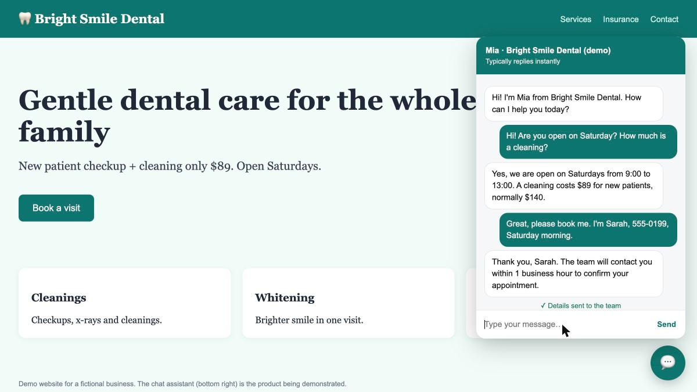

# AI Receptionist Agent

A multi-tenant AI assistant for small businesses: a website chat widget and a voice receptionist (Telugu, Hindi, English) that answer **only from the business's own information** and turn conversations into leads.



## What it does
- **Answers from business data only** — prices, hours, services, policies come from a per-business YAML file. A system rule forbids inventing prices or quoting services that are not listed; numbers are copied exactly.
- **Captures leads with a tool call** — a strict-schema `capture_lead` tool (name, phone/email, need, urgency) validates input and writes to SQLite.
- **Hands off when unsure** — offers a call-back from staff instead of guessing.
- **Voice mode** — browser speech recognition + speech synthesis; replies in the caller's language (te-IN / hi-IN / en-IN).
- **One engine, many businesses** — onboarding a new business = adding one `tenants/<id>.yaml`.

## Stack
Python 3.12 · FastAPI · SQLite · Anthropic Claude API (tool use) **or** free local models via Ollama (qwen2.5 for English, gemma3 for Telugu) · vanilla JS widget (one `<script>` tag) · Playwright for recording demos.

## Architecture
```
browser widget / voice page
        │  POST /api/chat/{tenant}
        ▼
FastAPI (app/server.py) ── validates ids, CORS for embeds
        │
        ▼
agent.chat_turn (app/agent.py)
   ├─ loads tenants/<id>.yaml → system prompt with guardrails
   ├─ provider: claude  → Messages API + capture_lead tool
   ├─ provider: ollama  → local model (tools optional per tenant)
   └─ SQLite: sessions (history) + leads
```

## Guardrails
- Answer only from the business information block; otherwise say you'll get the team to call back.
- Never round, estimate or change a price, day or time; keep "from" prices as "from".
- **Code-level price check:** every price in a reply must exist in the business info, on the line for the service being discussed. Otherwise the reply is replaced with a call-back offer - so a small model cannot attach a real price to the wrong service.
- Lead tool input is validated server-side before saving.
- Admin lead export requires `ADMIN_KEY`.

## Run locally
```bash
uv sync
cp .env.example .env      # add ANTHROPIC_API_KEY, or use provider: ollama in the tenant file
./run.sh                  # http://localhost:8000 (chat demo) and /voice (voice demo)
```

## Embed on any site
```html
<script src="https://your-host/widget.js" data-tenant="demo-dental"></script>
```

## Status
Working demo with two fictional businesses (`demo-dental`, `demo-clinic-te`). Not yet in production.
